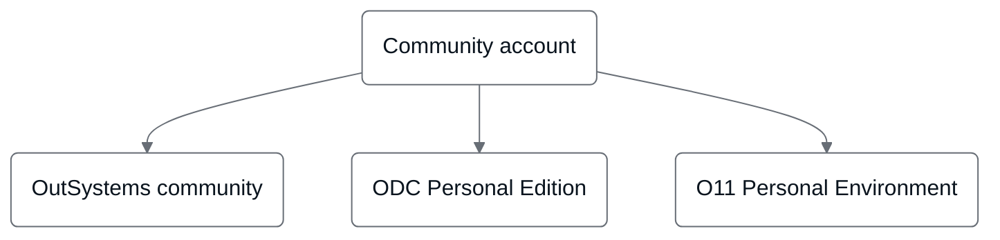

# OutSystems community

The OutSystems community serves as a global hub where developers, architects, and IT professionals come together to collaborate, learn, and innovate using the OutSystems platform. In addition to facilitating knowledge sharing and professional connections, a community account provides access to key tools and services for managing profiles, support cases, and company settings.

Your community account is the single login for the [OutSystems community](https://www.outsystems.com/community/), [ODC Personal Edition](https://www.outsystems.com/personaledition/), and [O11 Personal Environment](https://www.outsystems.com/Portal/Trial_Portal).

The following diagram shows the three places where your community account is the single login.

## What can you do with an OutSystems community account?

A community account provides access to a wide range of features and resources.

### Participate in the community

Your community account enables you to fully engage with the OutSystems ecosystem:

* [Forums](https://www.outsystems.com/forums/): Connect with peers and experts in discussions to share knowledge and solve challenges.
* [Events and user groups](https://usergroups.outsystems.com/): Participate in virtual and in-person events to network and stay informed about the latest trends in low-code development.
* [Free online training](https://learn.outsystems.com/training/create-path): Share your learning goals to get a customized plan designed to boost your skills and advance your career.

For more information, refer to the [OutSystems community](https://www.outsystems.com/community/).

### Access support services

* [Opening a support case](open-support-case.md): Submit and manage support cases directly through your community account to address technical challenges or questions.
* [Enhanced security for OutSystems support cases](support-cases-security.md): Ensure secure access to support case information, protecting sensitive data during interactions with OutSystems support teams.

### Manage your company's settings

* [Managing your company permissions in Customer Portal](customer-portal.md): Configure company-level permissions, manage team member roles, and control access to resources through your community account.

### Manage your profile

With your community account, you can maintain and update your personal account information efficiently:

* [Change your password](change-community-pw.md): Enhance account security by updating your password as needed.
* [Change your email](change-community-email.md): Ensure that your contact information remains accurate for receiving important updates.
* [Close your account](close-community-account.md): Manage the deactivation process for accounts that are no longer in use.
* [Merge two accounts](merge-accounts.md): Consolidate multiple accounts to simplify access and maintain consistency across interactions.

The OutSystems community extends beyond technical resources, offering opportunities to connect and grow professionally:

* **Global collaboration:** Engage with peers and experts from around the world to exchange insights and solutions.

* **Access to powerful resources:** Use forums, training modules, and Forge to accelerate project development.
* **Integrated security workflows:** Use your community account to manage sensitive data securely within the OutSystems ecosystem.

An OutSystems community account is a key resource for maximizing the potential of the platform. It provides a centralized way to manage support, maintain profile information, and access company resources. By using the tools and connections available, you can enhance your productivity and foster professional growth.
