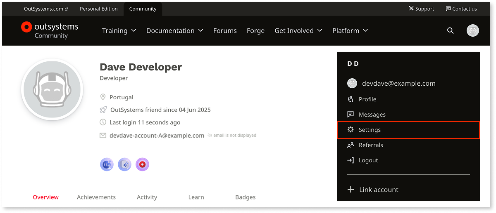
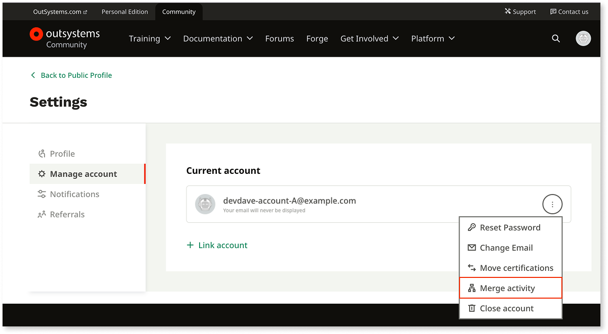
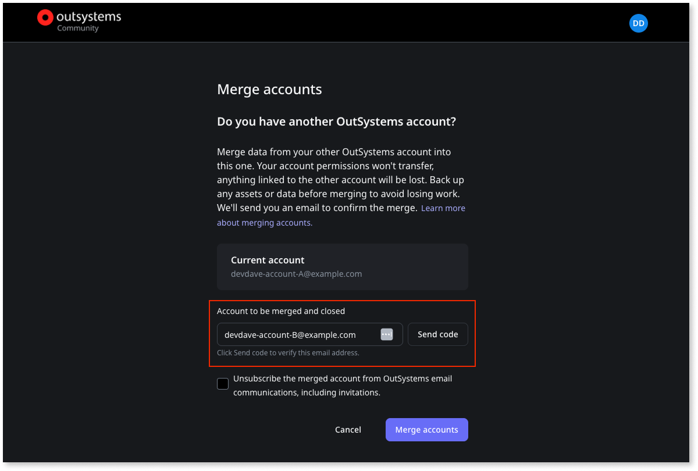
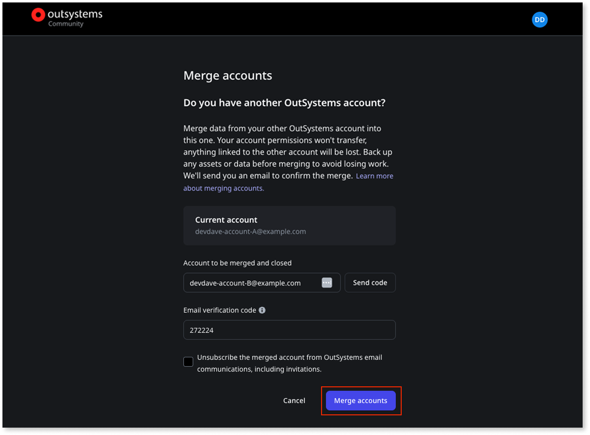
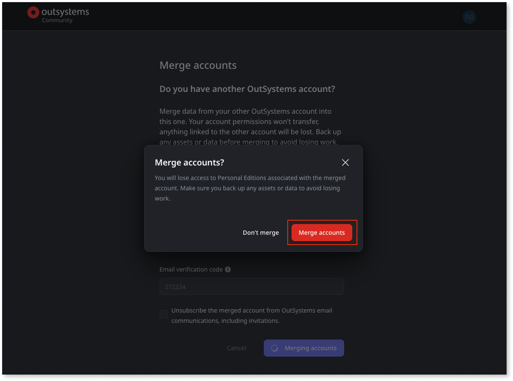

---
audience:
  - Developer
summary: Learn the process of merging two community accounts into one and what information transfers.
coverage-type:
  - apply
topic:
  - merge-community-accounts
tags:
  - Authentication
  - End-users
  - Forge
  - Settings
locale: en-us
guid: 6EDE38E2-A209-4BB9-8C48-CE902CD0094C
app_type: traditional web apps, mobile apps, reactive web apps
platform-version: o11, odc
figma: https://www.figma.com/file/mP34OzloL9EPqXml1E0tfC/Community?node-id=1356:241
isautopublish: true
---

# Merging two OutSystems community accounts

If you have two community accounts with distinct emails, for example one with your personal email and another with your work email, you can merge them into one. The merge moves your community information into the account you keep and deletes the other account.

For more information about transferring your certifications while keeping both accounts active, refer to [Transfer certification](training/transfer-certification.md).

The following terms identify the two accounts in this article:

* Account A is the account you want to keep.
* Account B is the account that merges into account A and is deleted.

The merge destroys the Personal Environment and Personal Edition of account B. Most other community information moves to account A. OutSystems deletes anything else linked to account B, including account permissions.

To avoid losing work, back up any assets or data from account B that you want to keep before you merge.

You can't revert an account merge.

Before you begin, make sure you can access the email address of account B, because the verification code goes to that address.

To merge two accounts, follow these steps:

1. Log in to the OutSystems website with account A.

    If you forgot your password, select [Forgot password?](https://www.outsystems.com/home/RequestPassword.aspx) on the login page.

1. In your profile menu, select **Settings**.

    

1. Select the **More options** icon, then select **Merge activity**.

    

1. Enter the email address of account B and select **Send code**. Then check the inbox of account B for the verification code.

    

1. Enter the verification code, then select **Merge accounts**.

    

1. In the confirmation dialog, select **Merge accounts**.

    

    OutSystems sends two emails: one to account A to confirm the merge, and one to account B to notify you that it's closed.

## Information transferred during a merge

The merge transfers the following from account B into account A, which then contains the combined information from both accounts.

* Community forum posts and votes on those posts
* Forge component ownership, votes, and subscriptions
* Online course progress
* Technical certifications, sales certifications, and bootcamps
* Ideas, comments, and likes on ideas
* Accomplishments on the Overview tab of your profile and achievements
* Private messages

The profile creation date is the earlier of the creation dates of account A and account B. The same applies to the dates of the following badges: Welcome, Profile Superstar, First Idea, First Component, First Post, and MVP.

## Information not transferred during a merge

The merge doesn't keep your Customer Portal or Partner Center permissions, because both contain sensitive information that only authorized people can access. Ask the administrators of those tools to add you after the merge.
