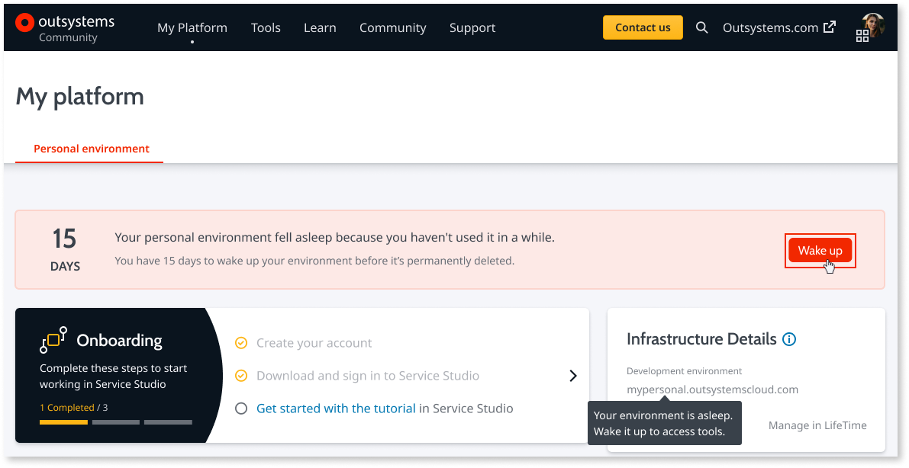

# Cannot reach apps on my personal environment

This article applies to OutSystems 11 (O11) personal environments only.

## Symptoms

You're trying to access an app running on your O11 personal environment, but you're redirected to [http://www.outsystems.com/home/](http://www.outsystems.com/home/). A message tells you that your personal environment fell asleep or was deleted.

## Cause

Your O11 personal environment is asleep. This occurs when:

* You stopped developing for a while.
* Your apps aren't being used.

This happens as part of the recycling mechanism that saves resources for active personal environments.

## Resolution

Go to the [Trial Portal](https://www.outsystems.com/Portal/Trial_Portal) and log in with your OutSystems Community account. Select **Wake up** and wait a few seconds while the personal environment is restored.

## More information

OutSystems sends you an email letting you know that your personal environment will be recycled.

If you need your personal environment running 24/7, check your emails regularly. A couple of visits per week to your apps is enough to keep the environment active.
